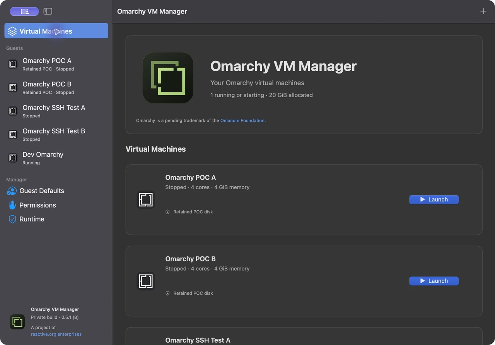

# Omarchy VM Manager user guide

Create independent Omarchy guests, configure their resources, and connect from your Mac over SSH. This guide describes the current private macOS build, **0.9.3 (16)**.

## Start here

- [Getting started](getting-started.md): open the app, set up reusable defaults, create a guest and launch it.
- [Manage your guests](managing-guests.md): change resources, use SSH, assign a Space, shut down and delete guests.
- [Prepare a factory image](preparing-factory-images.md): customise a lean build, prepare a compatible bundle and select it for a new guest.
- [Use the CLI](cli-quickstart.md): create with per-VM owner overrides, wait for SSH, inspect, stop and reconfigure from a terminal.
- [Troubleshooting](troubleshooting.md): Super shortcuts, clipboard, startup and SSH readiness.

## A quick look

[Watch or download the 48-second MP4 tour](media/quick-tour.mp4) · approximately **748 KB**.

The silent tour is assembled from real screenshots of the running manager. It shows stopped-guest settings, experimental suspend readiness and the factory import form; it is not a continuous recording of installation or guest startup. The twelve screenshots and video together are approximately **1.2 MB**. [Captions and a text transcript](media/README.md) are included.

Screenshots were captured on 1 November 2026. Guest names and the illustrated SSH port belong to this installation; yours will differ. The New VM, configuration and factory import forms were cancelled. No guest was launched, changed, shut down or deleted for these captures. Both existing guests remained stopped. The SSH and configuration images are cropped to omit a personal public-key fingerprint and generated guest hostname.

## Current capabilities

| Task | Current behavior |
| --- | --- |
| Create guests | Independent disks; optional saved owner setup; SSH on by default |
| Configure | Name, CPU, memory, grow-only disk capacity, clipboard and immersive mode while stopped |
| Connect | NAT networking and a separate localhost SSH port for each enabled guest |
| Organize windows | Native Dock assignment to Mission Control Spaces |
| Remove a guest | Move its stopped guest folder to macOS Trash |
| Choose a factory | Official image or a verified compatible custom bundle, selected when creating a guest |
| Reuse downloads | Shared verified factory-image cache in Downloads |

The local 0.9.4 (17) update adds [CLI owner overrides](cli-quickstart.md#override-owner-settings-for-one-vm) for a new guest without changing Guest Defaults. Its app and CLI pass installation/bundle checks; creation and real boot with overrides remain untested. The screenshots above remain from 0.9.3 (16).

Shared folders, USB, camera, authentication bridges, general port-forward editing, snapshots and importing existing VMs are unavailable in this build. The library's retained POC entries keep their original configuration; stopped entries can be moved to Trash through the normal confirmed deletion flow.

## Further reference

[CLI reference](CLI.md) · [Factory images](../README.md#factory-images) · [Factory image cache](FactoryCache.md) · [Guest Defaults details](UnattendedDefaults.md) · [Managed SSH](ManagedSSH.md) · [Validation record](Validation.md)

This is a project of [reactive.org enterprises](https://www.reactive.org/). Omarchy is a pending trademark of the [Omacom Foundation](https://omarchy.org/foundation/).

[Pause and resume](PauseResume.md) explains manual execution control, host sleep/wake and shutdown.

[Guest display activation](GuestForegrounding.md) describes interactive launch intent, background automation and the remaining native macOS checks.

[Touch ID feature preparation](TouchID.md) describes the new password-approval flow and the provisioning profile still required before it can be used.

[Suspend-to-disk investigation](Suspend.md) records the clarified RAM-release requirement, pinned graphics blocker and proposed disposable hibernation POC.

- [Reviewed custom factories](CustomFactories.md): prepared-bundle review, import, creation-time selection and validation limits.
