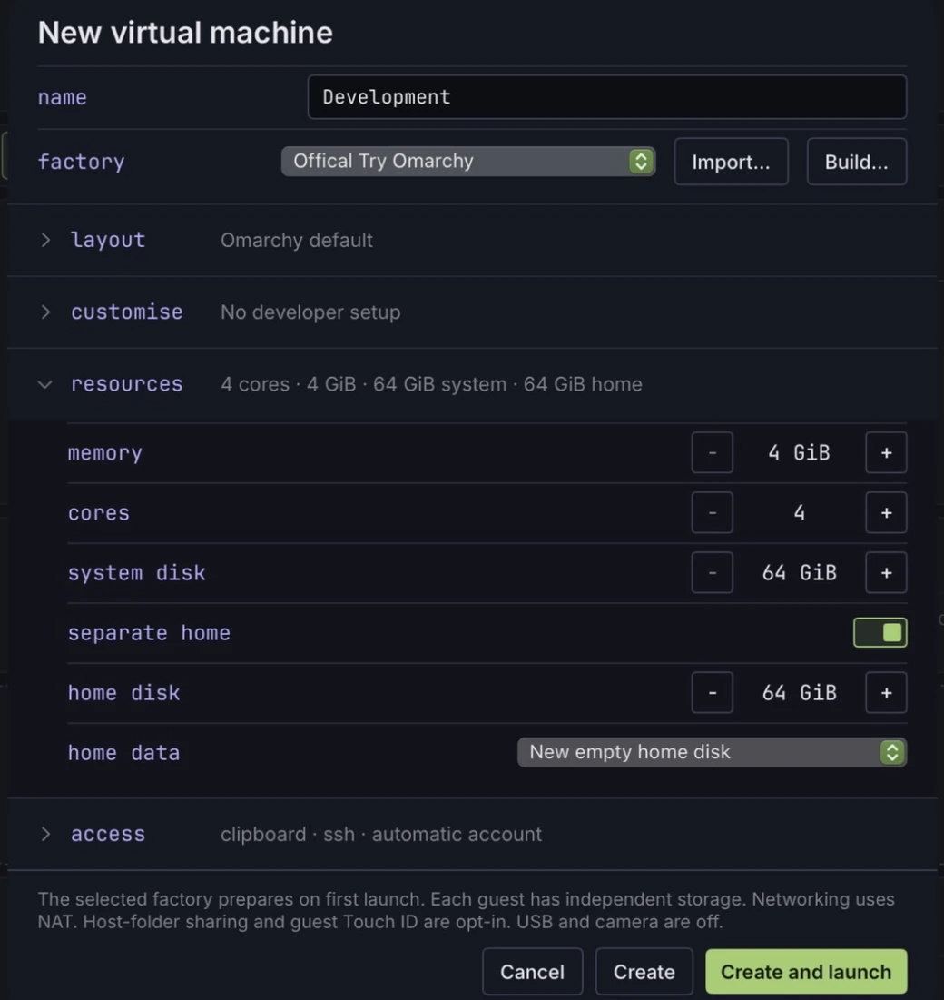
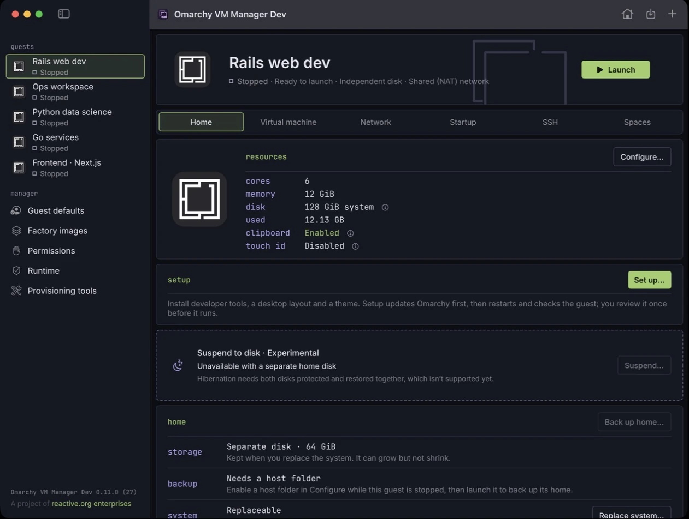
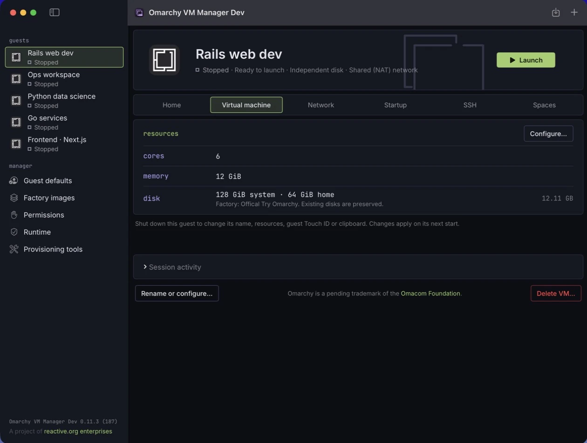

# Getting started

[User guide](README.md) · [Next: manage your guests](managing-guests.md)

## Open the manager

Use an Apple Silicon Mac running macOS 15 or later. Open **Omarchy VM Manager.app** from this project's `dist` folder. If you are building it yourself, follow the [repository build instructions](../README.md#build-and-check).

**Virtual Machines** is your library. Select a guest in the sidebar to inspect it. Opening the app restores the list without starting guests. Scroll the library to see additional entries.

## Set up defaults once

Choose **Guest Defaults** in the sidebar to reuse your preferred owner setup for future guests:

1. Enter a username and password. Add a full name and Git email if wanted.
2. Choose a hostname prefix, time zone and keyboard.
3. Optionally choose an existing SSH **public** key using **Choose .pub…**.
4. Click **Save Defaults**. Saved account values apply automatically to new VMs;
   there is no separate global enable checkbox.

The password stays in the manager's scoped macOS Keychain storage. Development builds can use saved login-Keychain credentials; provisioned builds use protected credentials and may need an explicit upgrade of older passwords. See [Touch ID setup and build requirements](TouchID.md). New guests receive a snapshot of these settings and a unique hostname suffix; changing defaults leaves existing guests unchanged. To opt out for one new guest, select **Set up account manually** in its New VM form. With no saved password, the form explains that account setup will be manual. Older saved defaults apply even if their former global enable flag was off; existing guest snapshots are never changed.

For different owner settings on just one VM, the updated CLI supports [per-VM owner overrides](cli-quickstart.md#override-owner-settings-for-one-vm). It inherits the saved password and any omitted settings without saving changes to Guest Defaults. These flags require a matching manager and CLI build, included in the local 0.9.4 (17) update; the pictured New VM form does not expose individual owner overrides.

## Create a guest

Click **+** in the toolbar, or press **Command+N**.

Give the guest a distinct name, such as **Development**, then choose its options:

| Option | What it does |
| --- | --- |
| Factory image | Choose the official image or a verified compatible custom factory |
| Disk capacity | Choose the guest’s sparse disk capacity; new guests default to 64 GiB |
| Memory and processor cores | Start with 4 GiB and four cores; allocate more when needed and within your Mac's available budget |
| Clipboard integration | Share text with the Mac while this guest is focused |
| Immersive Mode | Open full screen with the Mac menu bar and Dock hidden |
| Set up account manually | Optional opt-out from saved account defaults for this VM; leave off to use the saved username, password, keyboard and system settings |
| Enable SSH from this Mac | Provision separate guest keys and a unique localhost connection port; enabled by default |
| Personal public key | Optionally enroll your existing `.pub` key alongside the manager's key |

Click **Create VM**. This saves the profile; the guest disk is created on its first launch. SSH enrollment and owner setup are chosen at creation and cannot be changed through the current configuration form.

In builds with **Developer setup**, Source **None** creates a VM without a setup
selection. For **Bundled configuration** or a **Local setup folder**, choose the
profiles and optional theme/layout, then click **Create VM**. This action validates
and saves a copy of the selected inputs with the profile. There is no separate
Review setup action or selection-confirmation checkbox in New VM. Creation does
not run setup or grant task trust, sudo or Docker permissions; those are reviewed
separately before execution.

If **Create VM** is disabled, the message above the buttons explains the missing
name, folder or profiles, invalid theme/layout choice, or unavailable setup service.
While creation prepares inputs, the form shows progress and prevents duplicate
submissions. Preparation errors appear in the form without creating a VM; correct
the selections and try Create VM again.

## Launch and connect

Select the guest and click **Launch**. The manager selects its Home card and scrolls to the top so preparation and download progress are visible. Launching through the CLI selects the same card when the manager observes the new session. You can switch to another guest or page while startup continues.

On first launch, the manager downloads the official factory image if it is not already cached, verifies it, and prepares the guest disk. Progress appears beside the guest's icon. The shared image is kept in `~/Downloads/Omarchy VM Manager/Factory Images/` for reuse by later guests. See [cache behavior](FactoryCache.md) for retention and disk-space details.

With saved owner defaults, setup continues automatically. Otherwise, complete the normal setup wizard in the guest window. **Running** means the VM has reached its runtime-ready boundary; account setup and SSH can still be finishing.

Both guests remained stopped during capture. The example’s 20 GiB allocation illustrates an existing configuration, not the suggested starting size. The Home page’s experimental suspend panel does not establish that this guest can hibernate; see [suspend requirements and limitations](Suspend.md).

### When setup needs you

Developer setup sometimes waits for you: Omarchy asks to enable passwordless sudo
in the setup terminal, or a review of the restart, the configuration check or
cleanup is ready. The guest then shows **Needs you** in the sidebar; click it to
open the setup output at the prompt, or the review. While a run is blocked the
Dock icon bounces once if the manager isn't in front (it may also show **!**, if
macOS allows badges for the app), and macOS
shows one notification naming the guest and what it's waiting for. The manager
asks for notification permission when it opens; the badge and Dock still work if
you decline. A saved setup that is simply waiting for your review only shows the
sidebar badge. If a step runs out of time, the failure names it, for example
"Omarchy’s passwordless sudo prompt wasn’t answered within an hour".

If a run stopped before its temporary admin access was confirmed removed and the
guest has since stopped, cleanup can no longer be verified and the guest is held:
it can't be launched, configured or deleted, and other guests can't start setup.
Open its setup sheet (**Open setup…** on the first-run card, or **Review cleanup…**
on the setup card) and click **Release cleanup hold…**, then confirm. The
confirmation says cleanup wasn't verified; the guest may still allow passwordless
sudo, which you then remove inside the guest. Setup history keeps showing that the
hold was released without verification.

Other setup steps that wait for you (**Restart guest**, **Check after restart** and
**Recover cleanup**) take a single click: the manager prepares the step for that
guest's current state and runs exactly that.

For terminal access, open the guest's **SSH** tab. Once its connection is verified, choose **Copy SSH Command** and paste the command into Terminal on your Mac. See [SSH and networking](managing-guests.md#connect-over-ssh).

For Omarchy keyboard shortcuts, enable the manager's Accessibility access as described in [Super shortcuts](troubleshooting.md#commandspace-opens-mac-spotlight).

## Finish a session

Save your work in the guest, then click **Shut Down** in the manager. Wait for **Stopped** before configuring or deleting it. Use **Force Stop…** from the ellipsis menu only when you need to power it off immediately; unsaved work can be lost.

[Next: manage your guests](managing-guests.md)
