# Getting started

[User guide](README.md) · [Next: manage your guests](managing-guests.md)

This guide takes you from opening the manager to a ready Omarchy guest. As the example, you'll create **Example VM**, a guest with the **Four terminals** desktop layout and the **Developer** setup profile, and follow it through its first run. Allow 15–20 minutes; most of that is the guest downloading and installing software while you do something else.

You need an Apple Silicon Mac running macOS 15 or later.

## Open the manager

Open **Omarchy VM Manager.app** from this project's `dist` folder. If you're building it yourself, follow the [repository build instructions](../README.md#build-and-check).

The library lists your virtual machines in the sidebar and on the main page, with each guest's state, cores, memory and disks. Opening the app restores the list without starting any guest.

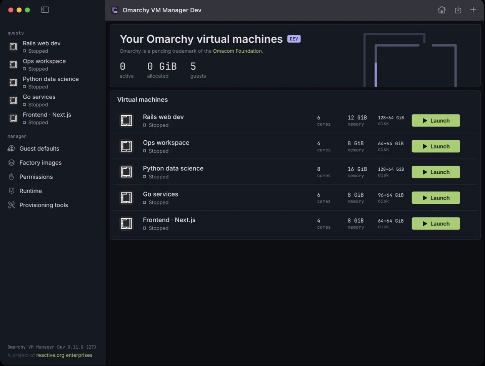

## Save your account defaults once

New guests can set up their owner account automatically. Choose **Guest defaults** in the sidebar:

1. Enter a username and password. Add a full name and Git email if you want them.
2. Choose a hostname prefix, time zone and keyboard.
3. Optionally choose an existing SSH **public** key with **Choose .pub…**.
4. Click **Save defaults**.

The same page has **Save disk defaults** for new guests' disk sizes and **Save desktop defaults** for their desktop.

Saved defaults apply to every new VM; there is no separate on switch. The password stays in the manager's own macOS Keychain storage. Development builds can use saved login-Keychain credentials; provisioned builds use protected credentials and may need an explicit upgrade of older passwords (see [Touch ID setup and build requirements](TouchID.md)). Each new guest receives a snapshot of these settings and a unique hostname suffix, so changing defaults later leaves existing guests unchanged. To skip automatic setup for one guest, turn on **manual account** in the **access** section of its New VM form.

For different owner settings on just one VM, the CLI supports [per-VM owner overrides](cli-quickstart.md#override-owner-settings-for-one-vm). They inherit the saved password and any settings you leave out, without changing Guest defaults.

## Choose a factory

A factory is the disk image a new guest starts from. Open **Factory images** in the sidebar to see your library: the official Try Omarchy image, and any lean or custom factories you've built or imported. Each custom card shows its Omarchy channel, version and build time, so factories with the same name are easy to tell apart.

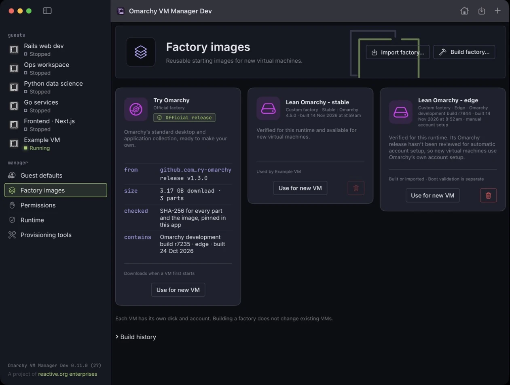

The trash button on a custom card moves that factory to the Trash, so you can restore it. A factory a VM still uses can't be removed; its card says which VM uses it.

Developer setup updates Omarchy before installing your selections, and that update currently fails on the official image. For a guest with developer setup, use a lean factory: build one with **Build factory…** (see [Build a lean factory in Dev](FactoryBuilding.md)) or import a prepared one with **Import factory…** (see [Prepare a factory image](preparing-factory-images.md)). When a factory is ready, **Use for new VM** opens the New VM form with that factory selected.

## Create Example VM

Click **+** in the toolbar, press **Command+N**, or use **Use for new VM** on a factory. Type **Example VM** as the name and check the **factory** row. Its menu lists each factory with its channel, Omarchy version and build time. **Import…** and **Build…** beside it add a factory without leaving the form.

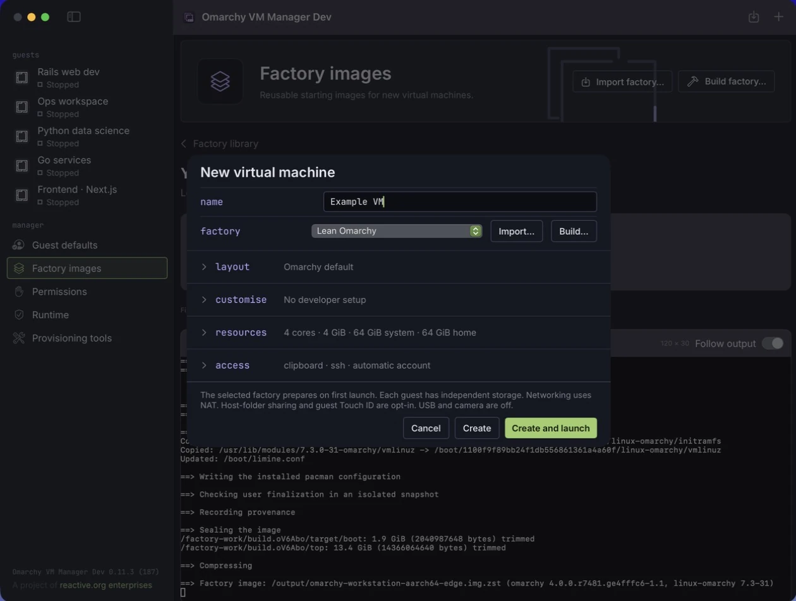

The rest of the form is grouped into four sections. Click one to open it; only one is open at a time, and each closed section shows a one-line summary.

### layout

Open **layout** and choose **Four terminals**. It's applied at the guest's next desktop login. Choosing a layout turns on developer setup, so **customise** now reads **Developer** and the main button becomes **Create, launch & set up**.

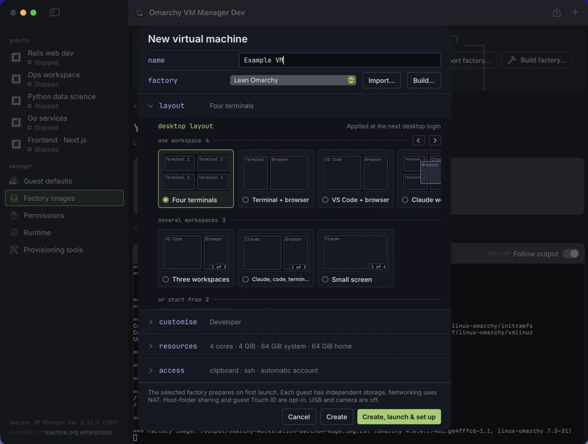

Other examples include **Terminal + browser**, **VS Code + browser** and layouts spread across several workspaces. You can also start from a layout file. Leave the layout as **Omarchy default** to keep Omarchy's standard desktop.

### customise

**customise** holds developer setup. **Source** is **None**, **Bundled configuration** or **Local setup folder**. With bundled configuration, combine profiles to build your workstation: **Developer** (command-line, Git and editor tools) is the base, and **Web**, **Python** and **Project managed** each add to it. Shared features are installed once. For Example VM, keep **Developer** on its own.

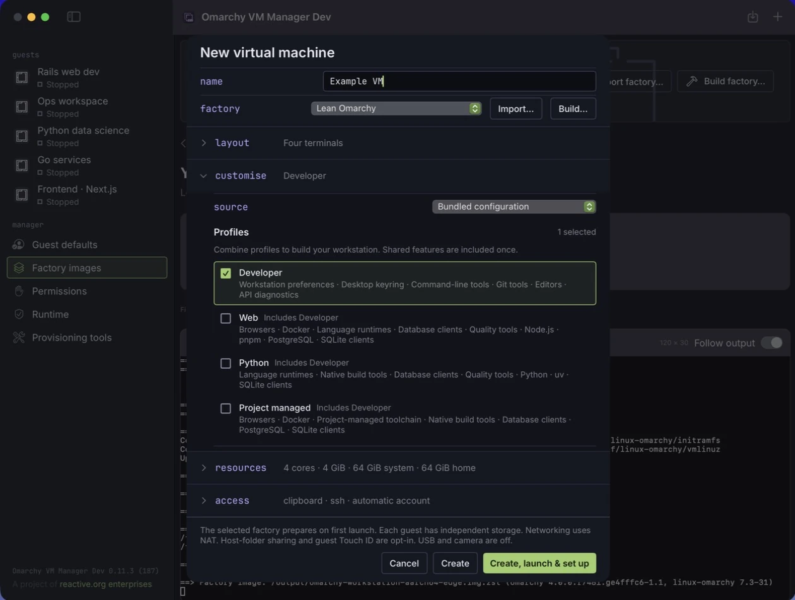

### resources

**resources** sets **memory**, **cores**, the **system disk**, and an optional **separate home** disk with its size and starting **home data**. New guests start with 4 GiB of memory, four cores and 64 GiB system and home disks; these defaults suit Example VM. Allocate more within what your Mac can spare. Disks only grow, never shrink.

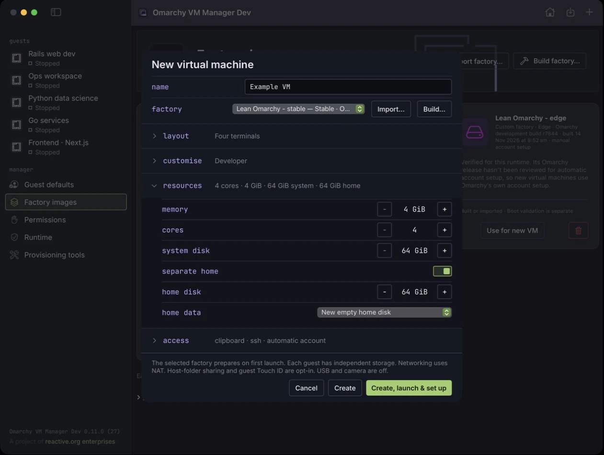

### access

**access** covers how the guest connects to your Mac:

- **clipboard**: share copied text while the guest is focused.
- **immersive mode**: open full screen with the Mac menu bar and Dock hidden.
- **touch id**: enable the guest Touch ID bridge (see [Guest Touch ID](GuestTouchID.md)).
- **host folder**: share a dedicated Mac folder at `/mnt/mac` (see [Native host folders](SharedFolders.md)).
- **manual account**: skip your saved account defaults for this guest.
- **ssh**: on by default, with a unique localhost port and per-guest keys.
- **public key**: optionally add your own `.pub` key alongside the manager's key.

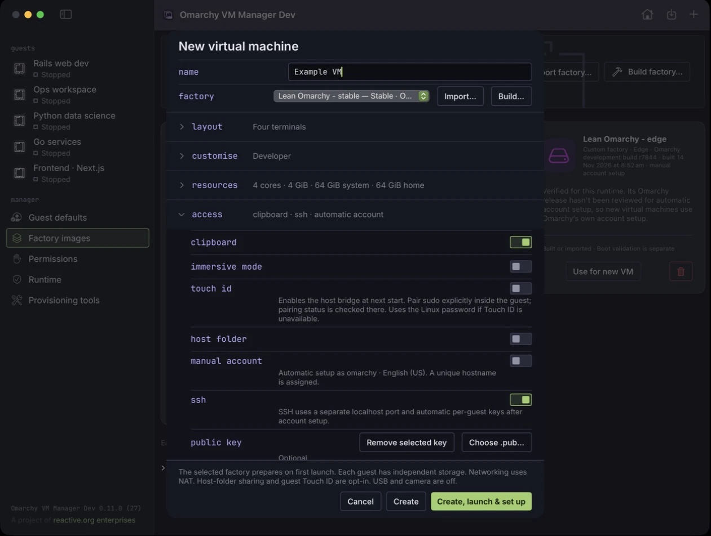

SSH enrollment and the owner account are fixed when the guest is created.

### Create it

Click **Create, launch & set up**. The manager validates your selections, saves a copy of the setup inputs with the profile and starts the guest. Creating it approves the setup run, including temporary admin access and the restart that finishes setup; nothing else needs confirming up front.

The other buttons are **Create**, which saves the guest without starting it, and **Create and launch** (shown when developer setup is off). If launching isn't available, the form offers **Create VM** instead and you launch the guest later from its page. If the buttons are disabled, the message above them explains what's missing, such as a name, folder or profile, and the relevant section opens.

## Watch the first run

The manager opens the new guest's **Home** page. A **first run** tracker shows each stage: **Created**, **Starting**, **First boot**, **Connecting**, **Installing**, **Restart** and **Ready**. You can switch to other guests or pages at any time; setup carries on.

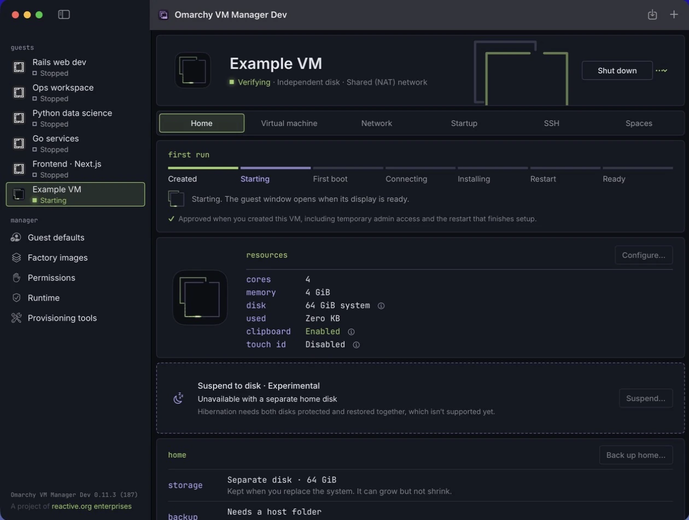

With the official image, the first launch also downloads and verifies the factory image. The download is kept for reuse by later guests; see [cache behaviour](FactoryCache.md). The guest window opens once its display is ready.

### When setup needs you

During **Installing**, Omarchy asks whether to enable passwordless sudo, which setup needs. The guest shows **Needs you** in the sidebar, and the **Live terminal** on its Home page shows the prompt. Answer it there: choose **Yes** or **No**, then press Return.

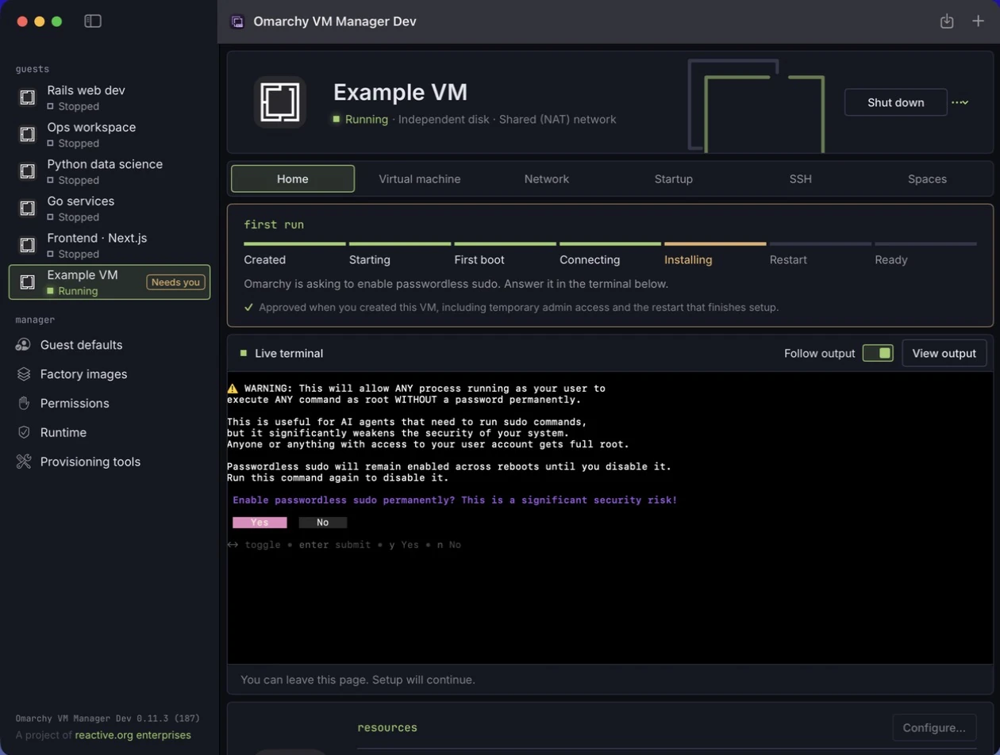

While a run is blocked, the Dock icon bounces once if the manager isn't in front, and macOS shows one notification naming the guest and what it's waiting for. The Dock icon may also show **!** if macOS allows badges for the app. The manager asks for notification permission when it opens; the badge and Dock still work if you decline. If a step runs out of time, the failure names it, for example "Omarchy's passwordless sudo prompt wasn't answered within an hour".

### Installing and restart

Setup then updates Omarchy and installs your selections. **Follow output** keeps the live terminal scrolled to the latest line, and **View output** opens the full log. Setup restarts the guest once, then checks the configuration.

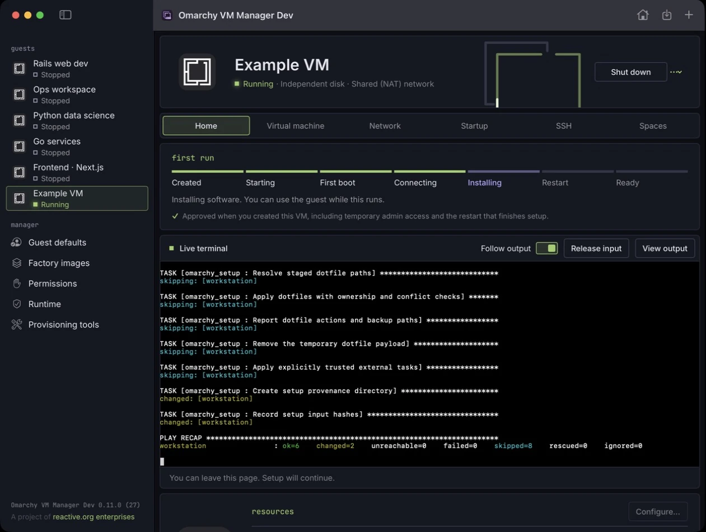

### Ready

When the tracker finishes, the Home page shows **Setup complete**. The **setup** card lists the installed software (**Developer**), the desktop (**Four terminals**) and the last run (**Succeeded**). **View output** shows the run again, and **Change setup…** adjusts it later.

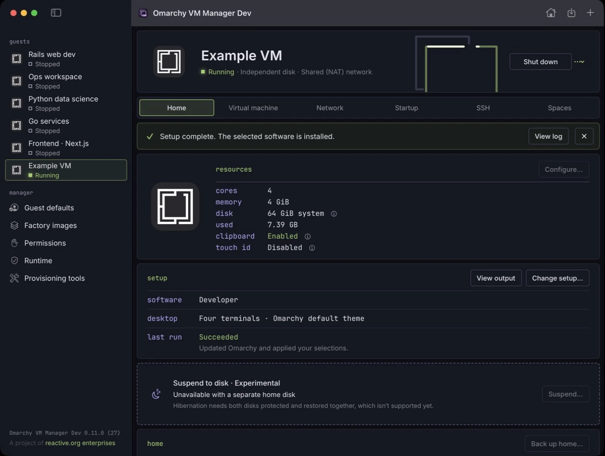

The guest window shows the four-terminal layout. Omarchy's welcome notifications appear at the top right until you dismiss them.

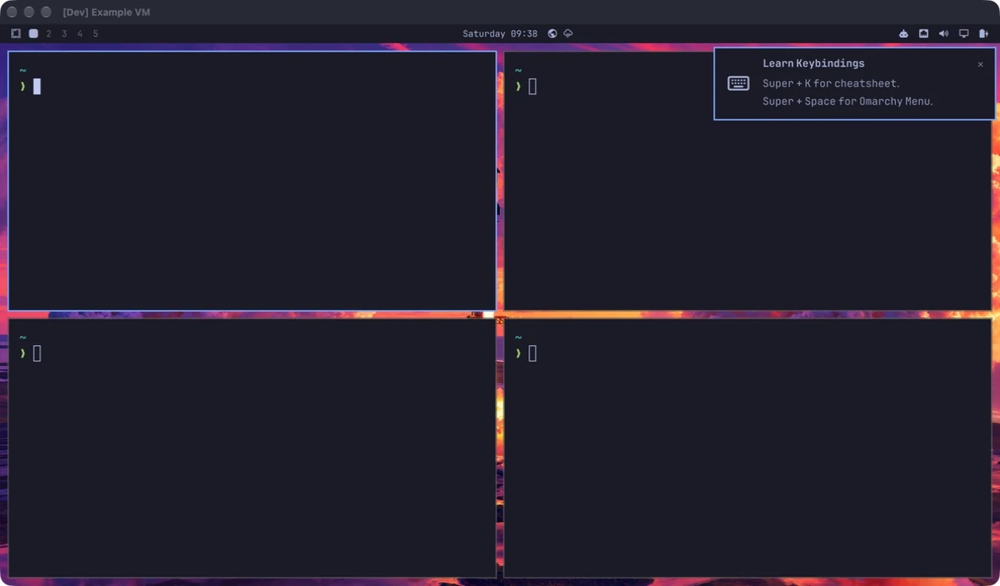

## Connect from your Mac

For a terminal from your Mac, open the guest's **SSH** tab. Once the connection is verified, choose **Copy SSH command** and paste the command into Terminal. See [SSH and networking](managing-guests.md#connect-over-ssh).

To use Omarchy's keyboard shortcuts, such as Super+Space, give the manager Accessibility access as described in [Super shortcuts](troubleshooting.md#commandspace-opens-mac-spotlight).

## If setup stops

Setup steps that wait for you, such as **Restart guest**, **Check after restart** and **Recover cleanup**, take a single click. The manager prepares the step for the guest's current state and runs exactly that step.

If a run stopped before its temporary admin access was confirmed removed and the guest has since stopped, cleanup can no longer be verified and the guest is held: it can't be launched, configured or deleted, and other guests can't start setup. Open its setup sheet (**Open setup…** on the first-run card, or **Review cleanup…** on the setup card), click **Release cleanup hold…** and confirm. The confirmation says cleanup wasn't verified; the guest may still allow passwordless sudo, which you then remove inside the guest. Setup history records that the hold was released without verification.

## Finish a session

Save your work in the guest, then click **Shut down** on its page. Wait for **Stopped** before configuring or deleting it. Use **Force stop…** from the **More** menu (the ellipsis beside **Shut down**) only when you need to power the guest off immediately; unsaved work can be lost.

[Next: manage your guests](managing-guests.md)
