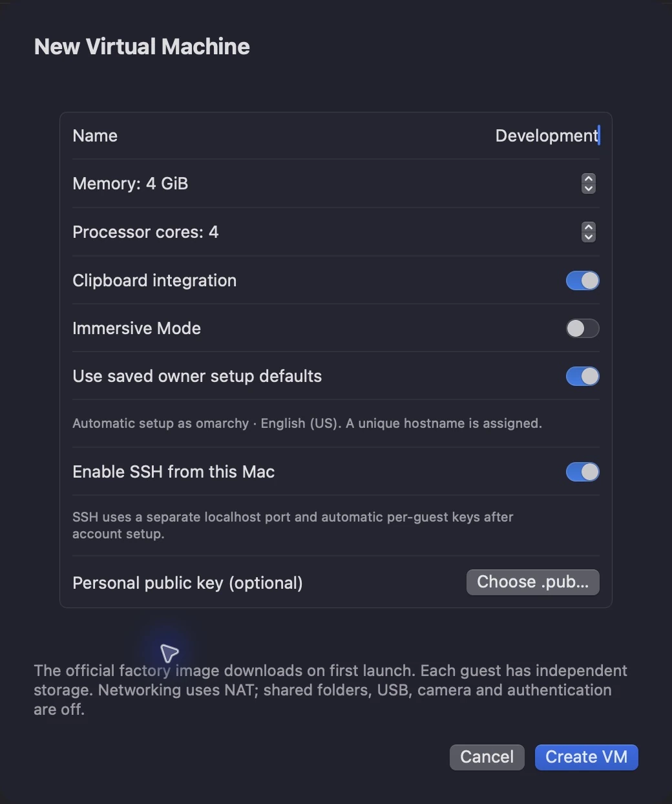
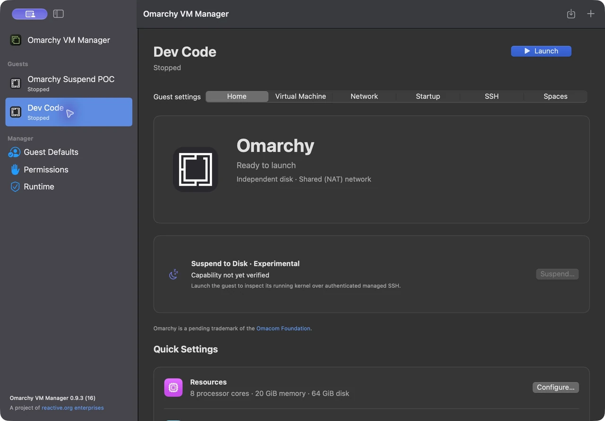
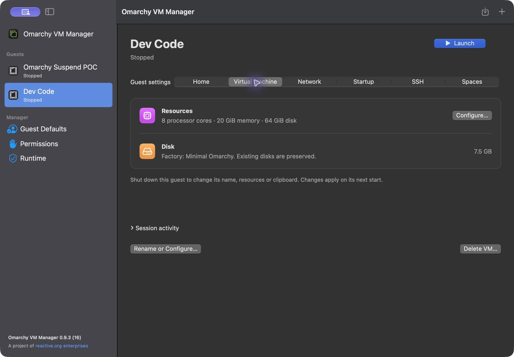

# Getting started

[User guide](README.md) · [Next: manage your guests](managing-guests.md)

## Open the manager

Use an Apple Silicon Mac running macOS 15 or later. Open **Omarchy VM Manager.app** from this project's `dist` folder. If you are building it yourself, follow the [repository build instructions](../README.md#build-and-check).

**Virtual Machines** is your library. Select a guest in the sidebar to inspect it. Opening the app restores the list without starting guests. Scroll the library to see additional entries.

## Set up defaults once

Choose **Guest Defaults** in the sidebar to reuse your preferred owner setup for future guests:

1. Turn on **Set up new guests automatically**.
2. Enter a username and password. Add a full name and Git email if wanted.
3. Choose a hostname prefix, time zone and keyboard.
4. Optionally choose an existing SSH **public** key using **Choose .pub…**.
5. Click **Save Defaults**.

The password stays in your login Keychain. New guests receive a snapshot of these settings and a unique hostname suffix; changing defaults leaves existing guests unchanged. You can choose manual setup separately for each new guest.

## Create a guest

Click **+** in the toolbar, or press **Command+N**.

Give the guest a distinct name, such as **Development**, then choose its options:

| Option | What it does |
| --- | --- |
| Factory image | Choose the official image or a verified compatible custom factory |
| Disk capacity | Choose the guest’s sparse disk capacity; new guests default to 64 GiB |
| Memory and processor cores | Start with 4 GiB and four cores; allocate more when needed and within your Mac's available budget |
| Clipboard integration | Share text with the Mac while this guest is focused |
| Immersive Mode | Open full screen with the Mac menu bar and Dock hidden |
| Use saved owner setup defaults | Apply your saved setup automatically; turn it off for the normal first-boot wizard |
| Enable SSH from this Mac | Provision separate guest keys and a unique localhost connection port; enabled by default |
| Personal public key | Optionally enroll your existing `.pub` key alongside the manager's key |

Click **Create VM**. This saves the profile; the guest disk is created on its first launch. SSH enrollment and owner setup are chosen at creation and cannot be changed through the current configuration form.

## Launch and connect

Select the guest and click **Launch**. The manager selects its Home card and scrolls to the top so preparation and download progress are visible. Launching through the CLI selects the same card when the manager observes the new session. You can switch to another guest or page while startup continues.

On first launch, the manager downloads the official factory image if it is not already cached, verifies it, and prepares the guest disk. Progress appears beside the guest's icon. The shared image is kept in `~/Downloads/Omarchy VM Manager/Factory Images/` for reuse by later guests. See [cache behavior](FactoryCache.md) for retention and disk-space details.

With saved owner defaults, setup continues automatically. Otherwise, complete the normal setup wizard in the guest window. **Running** means the VM has reached its runtime-ready boundary; account setup and SSH can still be finishing.

Both guests remained stopped during capture. The example’s 20 GiB allocation illustrates an existing configuration, not the suggested starting size. The Home page’s experimental suspend panel does not establish that this guest can hibernate; see [suspend requirements and limitations](Suspend.md).

For terminal access, open the guest's **SSH** tab. Once its connection is verified, choose **Copy SSH Command** and paste the command into Terminal on your Mac. See [SSH and networking](managing-guests.md#connect-over-ssh).

For Omarchy keyboard shortcuts, enable the manager's Accessibility access as described in [Super shortcuts](troubleshooting.md#commandspace-opens-mac-spotlight).

## Finish a session

Save your work in the guest, then click **Shut Down** in the manager. Wait for **Stopped** before configuring or deleting it. Use **Force Stop…** from the ellipsis menu only when you need to power it off immediately; unsaved work can be lost.

[Next: manage your guests](managing-guests.md)
