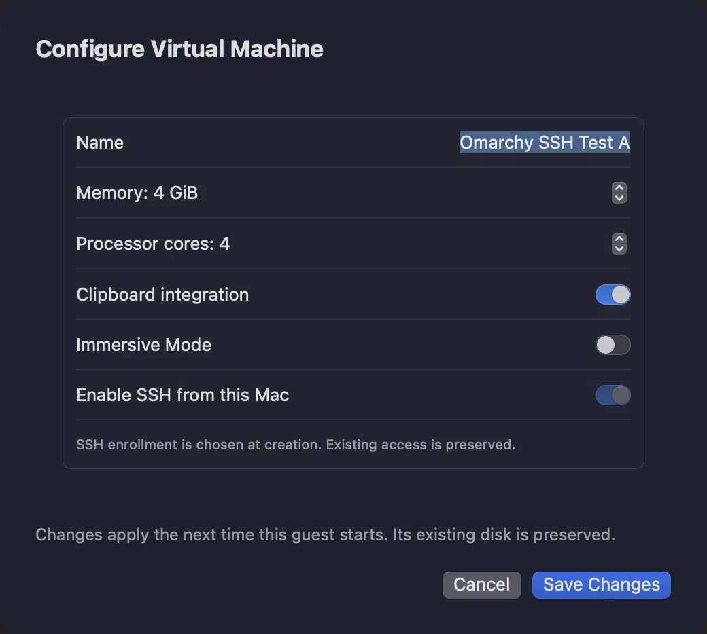
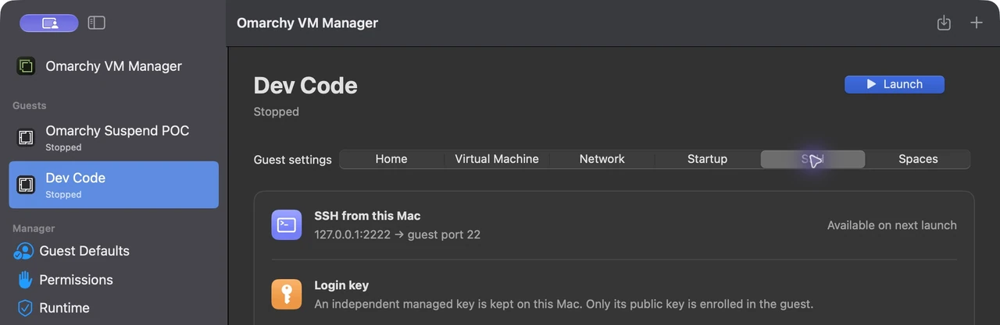
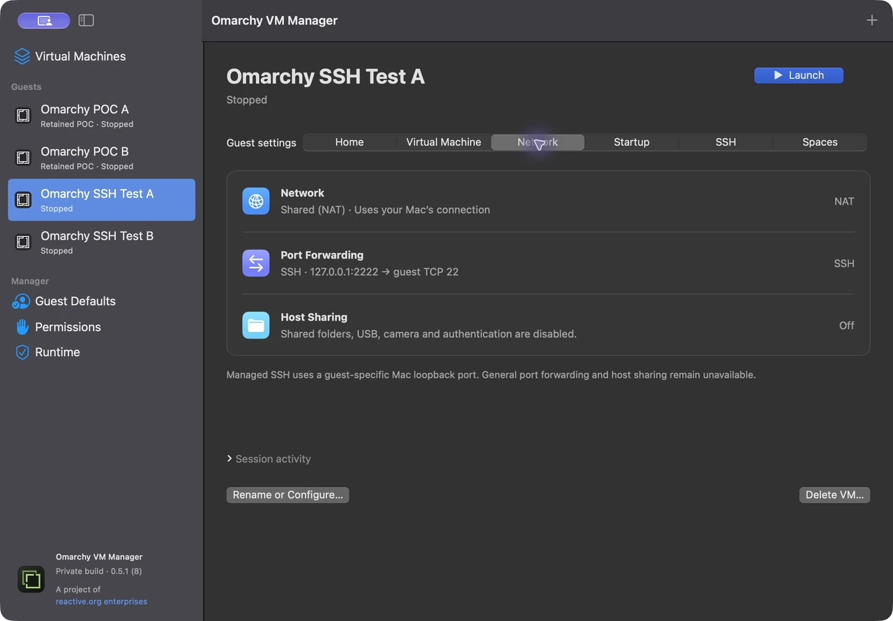
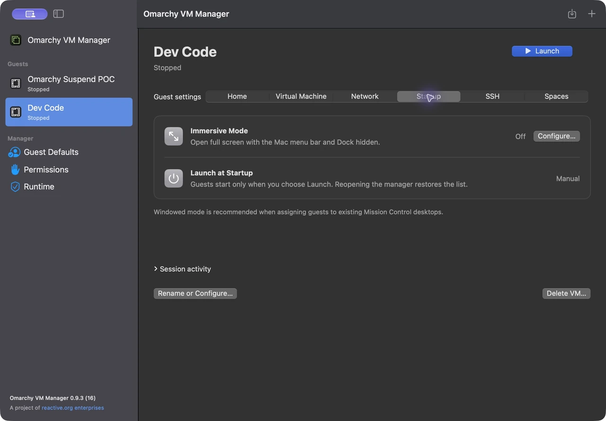
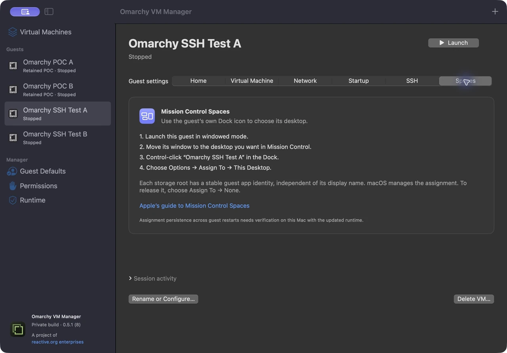

# Manage your guests

[User guide](README.md) · [Getting started](getting-started.md) · [CLI quick start](cli-quickstart.md)

## Change a guest's configuration

Shut down the guest and wait for **Stopped**. Select it in the sidebar, open **Virtual Machine**, then click **Configure…**. **Rename or Configure…** opens the same form.

Change its name, memory, CPU count, clipboard integration or immersive mode, then click **Save Changes**. Changes apply the next time you launch it, with its existing disk preserved. Running guests cannot be edited. Entries marked **Retained POC** are protected from edits and deletion.

SSH enrollment and the owner setup snapshot are fixed at guest creation. Create another guest if you need a different enrollment choice.

## Connect over SSH

Choose the guest's **SSH** tab. A stopped guest shows **Available on next launch**. After launch and account setup, the manager verifies its host key, authenticates, and makes **Copy SSH Command** available. Paste that command into a Mac terminal.

Every SSH-enabled guest has an independent managed key and a distinct localhost port. The generated command selects the correct key and pinned host identity. An optional personal public key can be chosen when creating the guest; private keys are not imported.

The **Network** tab shows the mapping. In this screenshot, `127.0.0.1:2222` on the Mac forwards to TCP port 22 in this particular guest. Your port may differ.

Use the generated command or localhost endpoint to connect from the Mac. The private guest IP reported by the CLI is informational: two NAT guests can both report `10.0.2.15`. General port-forward editing and shared folders are unavailable in this build.

## Choose windowed or immersive mode

The **Startup** tab summarizes immersive mode. Click **Configure…** while stopped to change it. Windowed mode is recommended for assigning guests to existing Mission Control desktops.

Guests start only when you choose **Launch** or issue a CLI start command. Reopening the manager does not automatically boot them.

## Assign a guest to a Mission Control Space

Each guest has its own Dock identity. Use its Dock icon to make the assignment:

1. Launch the guest in windowed mode.
2. Move its window to your preferred desktop using Mission Control.
3. Control-click the **guest's** Dock icon.
4. Choose **Options → Assign To → This Desktop**.

Choose **Assign To → None** to remove the assignment. The manager's **Spaces** tab keeps these instructions handy.

macOS manages this assignment. Persistence across guest restarts remains a documented verification item for the current private build.

## Pause and resume a guest

Open the running guest’s ellipsis menu and choose **Pause**. Wait for **Paused**; its main action changes to **Resume**. Pausing freezes guest execution while keeping its memory and resources reserved. It does not save a suspend image or free RAM. SSH and guest applications cannot respond while paused.

A manual pause survives Mac sleep/wake. **Resume** continues that guest; another guest can keep running independently. Use the paused guest’s ellipsis menu → **Shut Down** to resume it only for graceful shutdown. Configuration and deletion require **Stopped**. See [Pause/Resume behavior](PauseResume.md).

## Shut down and remove a guest

Save guest work, click **Shut Down**, and wait for **Stopped**. The ellipsis menu's **Force Stop…** requests immediate power-off and asks for confirmation.

To remove a stopped guest, choose **Delete VM…** at the bottom of its detail page and confirm the reviewed guest. Its entire guest folder moves to macOS Trash, and its library entry is removed. The shared factory-image download remains cached for other guests. A guest that has never initialized storage has only its profile removed.

A running guest cannot be deleted. The two retained POC profiles are also protected. Trashed files can be recovered through the Mac's normal Trash workflow; automatic restoration into the manager is not implemented.

Quitting the manager with guests running follows its coordinated shutdown flow. Exiting the short-lived CLI leaves guests running under the manager.

## Experimental suspend-to-disk

The guest Home page shows kernel capability and any missing hibernation prerequisites. The official factory kernel lacks hibernation, so **Suspend…** is disabled. A prepared guest can opt into an experimental attempt after confirming the known failure risks. Suspended disks use **Restore / Recover…**, with ordinary launch/configuration/deletion blocked until recovery is verified. A detected cold boot requires a guest administrator to clear any stale resume image before **Accept Cold Boot…**; it is not a successful memory restore. Finish recovery while that guest is running. A stopped unresolved restore needs manual recovery. See [requirements, recovery and current failures](Suspend.md).
