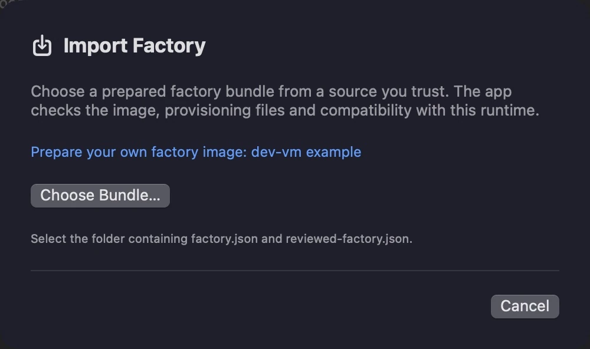

# Preparing and customising a factory image

[User guide](README.md) · [Factory images](../README.md#factory-images) · [Bundle contract](CustomFactories.md)

A factory is a sealed starting disk for new guests. Use the official Try Omarchy
image for its full application selection, or build a lean foundation with shared
packages and first-login preferences. Choose project-specific applications later
with [dev-vm](https://github.com/reactive-org/dev-vm)'s feature playbooks.

The manager imports prepared images and owns VM creation and integration. Image
building happens separately; it does not launch a VM or replace the official
factory, its cache or an existing guest's disk. This guide targets Apple Silicon
and ARM64 Omarchy with UEFI/Limine boot.

## Before you begin

Use an existing Omarchy VM Manager checkout and matching built app/CLI, plus a
[dev-vm checkout](https://github.com/reactive-org/dev-vm). The lean path below
matches the reviewed **0.9.3** runtime, integration package **0.1.0-43** and
`lean-e4fffc6` owner-setup contract. Check [Lean owner setup](LeanOwnerSetup.md)
when using another revision; factory compatibility is tied to exact runtime
hashes, rather than the app version alone.

Have Git, Python 3.10+, make and Docker already available on the Mac, with Docker
providing an ARM64 Linux engine. A full build needs the requested image capacity
plus 4 GiB free on the artifact volume and at least 3 GiB of Docker scratch space.
These instructions install no host tools. The package check and image build
download guest sources and packages; the full build uses a privileged container
for loop devices and mounts.

If you already have a compatible prepared bundle containing
`reviewed-factory.json`, go to [Import and select](#import-and-select).
For another builder's artifact, follow the [prepared-bundle contract](CustomFactories.md#prepared-bundle);
a compressed disk alone is insufficient.

## Choose your customisations

Make source changes in your dev-vm checkout before building. Its
[`docs/omarchy-image.md`](https://github.com/reactive-org/dev-vm/blob/main/docs/omarchy-image.md)
describes the build contract and validation limits.

| File in dev-vm | What to customise |
| --- | --- |
| `omarchy/image/base.packages` | Required package roots; pacman resolves their dependencies |
| `omarchy/image/excluded.packages` | Packages forbidden even when pulled in as dependencies |
| `omarchy/image/preferences/first-login.sh` | Idempotent preferences applied as the newly created graphical owner |
| `omarchy/image/preferences/PKGBUILD` | Version and dependencies of the preferences package |
| `omarchy/image/check-user.sh` | Acceptance assertions for your chosen first-login preferences |

For example, to include Chromium in every new guest, remove `chromium` from
`excluded.packages` and add it to `base.packages`. Leaving it in both fails
preflight. Dependencies can also bring in an excluded package; resolve that
conflict rather than bypassing dependency checks. To change the default Foot
size, edit `--foot-font-size 16` in `first-login.sh`, update the corresponding
`size=16` assertion in `check-user.sh` and increment the preferences package's
`pkgrel`. Keep its completion marker after all successful work, and keep
preferences safe to reapply. A fork with a different package profile must also
update tests that assert the stock selections, while retaining dependency,
provisioning, sealing and renderer checks.

Keep boot, graphics, networking, audio, recovery and native Mac integration
dependencies intact. Preserve hardware rendering: `llvmpipe`, `softpipe` and
forced software backends are unacceptable. Leave Retina, dynamic resolution,
clipboard and SSH integration to the manager and its pinned guest package.
Keep application/runtime updates under Omarchy and mise.

Keep the factory free of regular users, hostnames, passwords, tokens, SSH keys
and personal configuration. Supply per-guest identity through **Guest Defaults**
or the normal owner wizard. The builder seals machine identity and defers owner
creation to first boot; exporting an already configured personal VM is not this
workflow.

The reviewed owner programs are hash-pinned. Changing their bytes, the pinned
Omarchy revision or the integration source needs a separately reviewed contract
and matched runtime. The preparation tool accepts only its supported contracts;
editing hashes in metadata does not make arbitrary provisioning compatible.

## Build from the matching integration source

Set these two paths for your checkouts, then prepare the manager's reviewed
source. Resolve the real path because `.build/runtime-source` is a symlink and
the image builder refuses symlink source directories:

```sh
manager='/absolute/path/to/Omarchy VM Manager'
workstation='/absolute/path/to/dev-vm'
cd "$manager"
make prepare-source
integration_source=$(cd .build/runtime-source && pwd -P)
integration_commit=80156396a5daa795487c0f4a8308eee53f6ea68b
test "$(git -C "$integration_source" rev-parse HEAD)" = "$integration_commit"
```

The final check must succeed before continuing. Keep this generated source
clean. This revision retains the stock v1.3.0 factory builder and adds the
reviewed managed owner/SSH integration. The dev-vm builder produces the matched
hardware-policy package **0.1.0-43.1**, which the runtime preserves as newer than
its bundled 43 package. A stock-source build or older lean artifact is not a
substitute for this managed lean path.

Preview the inputs without Docker, downloads or disk creation:

```sh
cd "$workstation"
make build-omarchy-image OMARCHY_IMAGE_PLAN=yes \
  OMARCHY_IMAGE_TRY_SOURCE="$integration_source" \
  OMARCHY_IMAGE_TRY_COMMIT="$integration_commit" OMARCHY_IMAGE_SIZE_GIB=20
```

Then check package/provisioning compatibility and build the disk:

```sh
make check-omarchy-image \
  OMARCHY_IMAGE_TRY_SOURCE="$integration_source" \
  OMARCHY_IMAGE_TRY_COMMIT="$integration_commit" OMARCHY_IMAGE_SIZE_GIB=20
make build-omarchy-image \
  OMARCHY_IMAGE_TRY_SOURCE="$integration_source" \
  OMARCHY_IMAGE_TRY_COMMIT="$integration_commit" OMARCHY_IMAGE_SIZE_GIB=20
```

The check builds the guest packages and resolves dependencies without creating
a disk. The full build repeats those checks, builds a sparse UEFI/Btrfs image,
tests system setup and user finalisation in an isolated snapshot, removes the
test account and seals the factory. Use the successful directory printed as
`Verified output:` under `.artifacts/omarchy-image/`; `.building-*` directories
are failed or incomplete stages. Preserve the complete output and its
`SHA256SUMS`, package inventory, packages and provenance reports.

Arch repositories remain live. Source pins and build records do not promise
byte-identical rebuilds. These build checks also leave real boot, owner setup
and hardware rendering unproven.

After source customisations, run `make test-omarchy` and the shell/Python syntax
checks listed in dev-vm's README. Run `make syntax-check` if you changed YAML.

## Prepare a flat import bundle

Keep the complete build output intact. Copy the image and required evidence
into a new, separate directory; the manager rejects nested directories,
symlinks, special files and undeclared payloads:

```sh
artifact='/absolute/path/to/successful-artifact'
bundle="${artifact}.Manager.factory"
mkdir "$bundle"
cp "$artifact/factory.json" "$artifact/omarchy-workstation-aarch64-edge.img.zst" \
  "$artifact/compatibility.json" "$artifact/image-build.json" \
  "$artifact/source-compatibility.json" "$artifact/provisioning-check.json" \
  "$artifact/user-provisioning-check.json" "$bundle/"

cd "$manager"
python3 Scripts/prepare_factory_bundle.py "$bundle" \
  --name 'Custom lean Omarchy' --owner-contract lean-e4fffc6 \
  --compatibility compatibility.json --image-build image-build.json \
  --provisioning compatibility.json --provisioning image-build.json \
  --provisioning source-compatibility.json --provisioning provisioning-check.json \
  --provisioning user-provisioning-check.json
```

The tool checks the compressed image against `factory.json`, checks lean
compatibility/build evidence, writes `reviewed-factory.json` and prints its
SHA-256. The descriptor records the payload/evidence hashes and exact runtime,
integration package and owner contract. For an image preserving the supported
official owner programs, the default contract is `official`; use the
[general preparation command](CustomFactories.md#prepared-bundle) instead.

Use a real directory without symlinks in its path. Give each changed build a
fresh bundle: the tool preserves an existing descriptor rather than overwriting
it. Generate the descriptor only after finalising every payload. Preparation
records declared compatibility; it does not certify the publisher or prove
that the evidence produced the disk.

## Import and select



Open the matching manager app. An older running manager does not gain new
contracts from a newer CLI. In the app, choose **Import Factory**, select the
prepared directory and wait for verification. Then select the imported image
in **New VM → Factory image**. Importing from New VM selects it automatically.

The equivalent CLI flow uses the CLI inside that matching app:

```sh
cli='/absolute/path/to/Omarchy VM Manager.app/Contents/MacOS/omarchy-vm'
"$cli" factory-import "$bundle"
"$cli" factories
```

Copy the imported entry's exact `manifestSHA256` into the following command.
Save **Guest Defaults** first for automatic owner setup:

```sh
"$cli" create custom-factory-test --factory MANIFEST_SHA256 \
  --memory 4GiB --cpus 4 --disk 64GiB --owner-defaults on --ssh on
```

This creates metadata only. Use `--owner-defaults off` for the interactive owner
wizard instead. Choose a guest capacity at least as large as the factory disk
and within the CLI's 64–8192 GiB policy. Record the returned guest UUID.
Factory selection is fixed at creation; existing guests keep their own disks.

The manager copies imports into its private library with a verified local
receipt. Later changes to the original bundle do not change that copy. A
runtime inventory change requires newly prepared matching bundles. See
[local library and persistence](CustomFactories.md#local-library-and-persistence).

## Validate a disposable guest

When ready to boot the new test guest, use its returned UUID:

```sh
"$cli" start GUEST_UUID --wait ssh --timeout 1800
"$cli" get GUEST_UUID
```

Complete the wizard if you chose manual setup. Use the returned `ssh.command`
for the managed key and pinned host identity. Before adopting the factory,
verify owner setup, authenticated SSH, Foot preferences, accelerated Hyprland
and Quickshell rendering, clipboard in both directions, Retina/dynamic resizing,
restart and factory reset on disposable guests. Independent guests must have
independent identities. Reject software rendering. The
[dev-vm validation guide](https://github.com/reactive-org/dev-vm/blob/main/docs/omarchy-playbook-validation.md)
records the image-specific evidence and remaining limits.

With the test guest running, select any developer features from dev-vm, then
reapply to check idempotence:

```sh
cd "$workstation"
make apply-playbook VM_NAME=custom-factory-test \
  OMARCHY_VM_MANAGER_CLI="$cli" OMARCHY_FEATURES=workstation,browsers,languages
make check-omarchy-vm VM_NAME=custom-factory-test OMARCHY_VM_MANAGER_CLI="$cli"
```

Keep Omarchy's native update path and repeat relevant validation after updates.
The temporary provisioning compatibility packages and renderer policy can be
replaced by later upstream packages; no package holds or replacement updater
are installed.

When validation is complete, shut down each disposable guest:

```sh
"$cli" stop GUEST_UUID --wait
"$cli" get GUEST_UUID
```

Confirm shutdown reached the terminal `.exited` boundary and no test QEMU or
launcher process remains before offering to move its root to Trash. Preserve
any guest still needed for investigation.

To retire an image, remove its disposable profiles through the manager's normal
stopped-guest Trash flow, then use `factory-delete MANIFEST_SHA256`. Any remaining
profile reference blocks removal. Imported factories are not automatically
pruned, and deleting a guest leaves the import available. See
[factory deletion and recovery](CustomFactories.md#delete-an-unused-factory).
