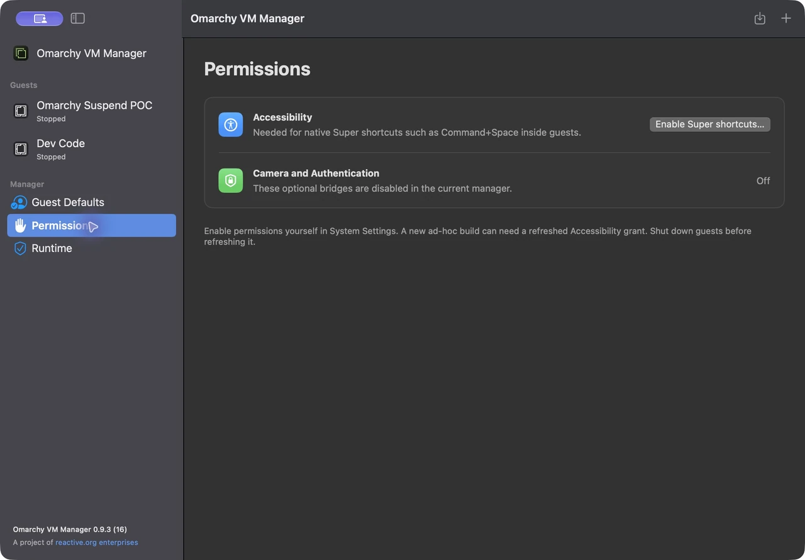
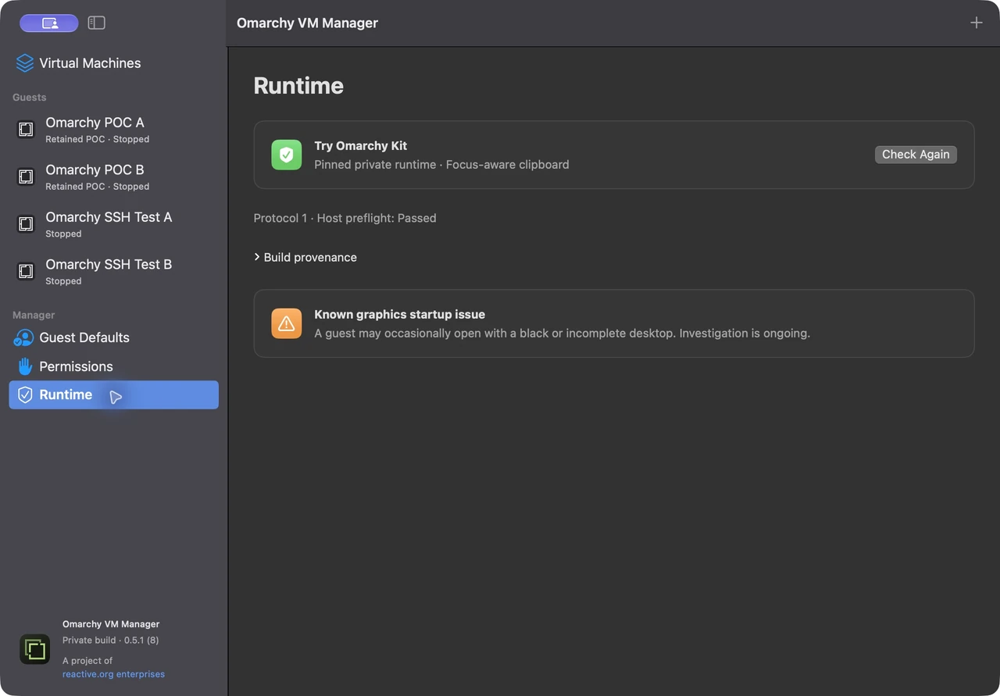

# Troubleshooting

[User guide](README.md) · [Manage your guests](managing-guests.md)

## Command+Space opens Mac Spotlight

The Mac Command key acts as Omarchy's Super key inside a focused guest. Capturing shortcuts such as Command+Space requires the manager's Accessibility grant.

1. Shut down the guests.
2. Open **Permissions** in the manager sidebar.
3. Click **Enable Super shortcuts…**.
4. In macOS Accessibility settings, enable **Omarchy VM Manager** yourself.
5. Return to the manager, launch a guest, click its desktop and try Command+Space.

The manager should show **Allowed** after the grant. Ad-hoc development rebuilds can need a refreshed entry through the same flow. This grant is separate from the installed Try Omarchy app's permission. Command+Return working by itself does not prove system-wide shortcuts are captured.

## Copy and paste do not work

Check that **Clipboard integration** is enabled in the stopped guest's configuration. Changes require another launch. Click the intended guest before copying or pasting; only the focused guest exchanges clipboard text with the Mac.

In Foot, paste uses **Ctrl+Shift+V**. Test with fresh throwaway text in both directions. If one guest fails, save work, shut down and relaunch that guest before retesting.

## A guest opens with a black or incomplete desktop

Intermittent graphics startup failure remains under investigation. Save work if possible, shut down the affected guest through the manager, then relaunch it. A successful restart has restored the desktop in earlier tests, but this is not a confirmed fix. Use **Force Stop…** only when graceful shutdown is insufficient and you accept losing unsaved guest work.

If managed SSH is ready, it can remain usable even when the graphical desktop is unhealthy. Do not reset or delete the disk to troubleshoot this symptom.

The **Runtime** page shows host preflight and the known graphics issue. **Check Again** refreshes the runtime checks; **Build provenance** identifies the pinned helper source.

## SSH is not ready yet

**Running** and SSH readiness are separate. First boot can still be installing integrations or creating the owner account. With manual owner setup selected, finish the normal wizard in the guest. With saved defaults, allow automatic setup to finish.

Inspect the guest's **SSH** tab, or use `./bin/omarchy-vm get "Guest Name"`. For a stopped guest, **Available on next launch** is expected. Use **Copy SSH Command** after verification; the generated connection checks the guest's host identity on every connection.

A CLI wait timeout leaves the guest running. Use `wait` to continue observing it. See the [CLI quick start](cli-quickstart.md).

## Launch, Configure or Delete is unavailable

Configuration and deletion require a stopped guest without an unresolved saved session. Retained POC profiles keep their original configuration but can use the normal confirmed Trash flow. Launch also requires compatible verified runtime files, host resources, free disk space and a free managed SSH port.

Read the guest's error and **Session activity** before retrying. If files or settings changed outside the manager, preserve them and resolve the reported conflict; replacing or deleting the guest is not an automatic recovery step.

## The image cache uses space in Downloads

The current compressed factory image is about 3.17 GB and is reused by new guests. Obsolete image downloads are cleaned up after at least seven days without use. Existing guests keep their own independent disks.

You can remove `~/Downloads/Omarchy VM Manager/Factory Images/` manually while no guest is being prepared. Existing guests can still boot; the next new guest downloads the image again. See [factory cache details](FactoryCache.md).
